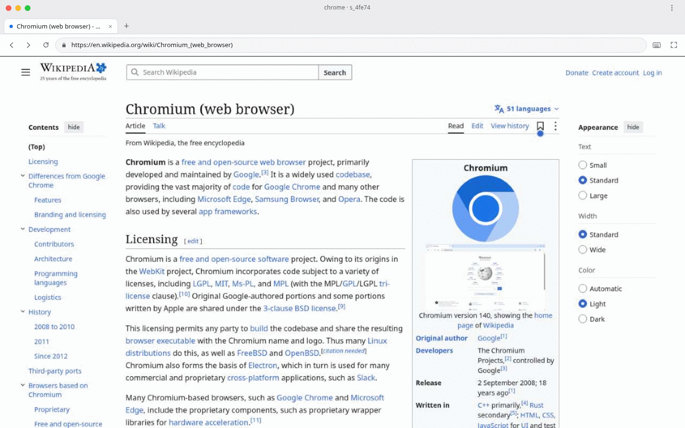
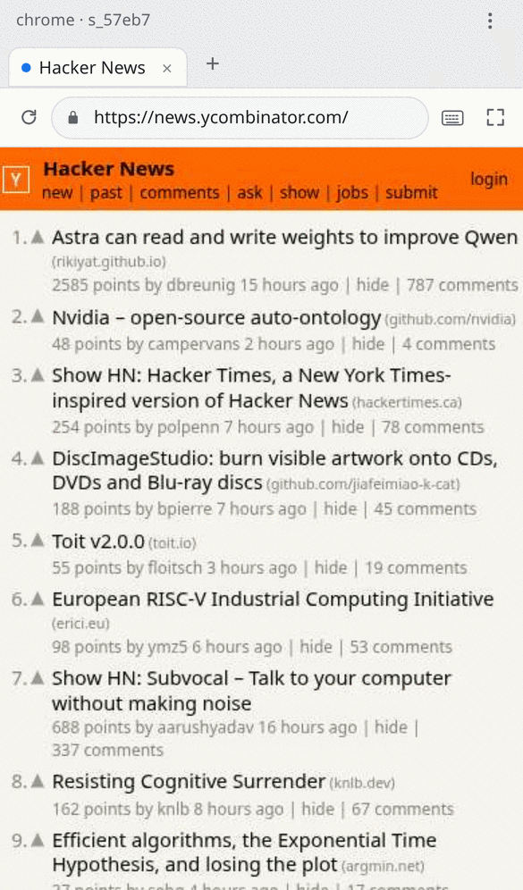

# chrome

[](https://github.com/SrihariPHS/chrome-remote/actions/workflows/ci.yml)

**A remote Chromium you drive with one intent per call — and watch from any device.**

Most "computer use" is slow because it moves pixels and one action at a time across
the network: screenshot → model → click → screenshot → model. This service keeps a
warm browser alive, gives the agent a *compact text view* of the page instead of an
image, and runs the waiting, looping and reacting **inside the tab**.

```
 agent ── one HTTP/MCP call ──►  session (warm Chromium)
                                   │  page-side SDK: snap / pulse / reflex
                                   │  direct CDP:    input, frames, screencast
                                   ▼
                              text tree + timers + changed numbers
 human ── one WebSocket ──►  live JPEG frames + take-control input
```

- **Warm** — one browser process, one CDP session per page. Nothing launches per call.
- **Compact** — a snapshot is 1–6 KB of refs (`@e12 button "Mars"`), not a 700 KB image.
- **Batched** — an 8-step form fill is one call, returning the new page state.
- **Time-aware** — `pulse` reads timers with their rate; `reflex` reacts in 4–16 ms inside the page.
- **Frame-aware** — cross-origin iframes are snapshotted and clicked with the right offsets.
- **Human-friendly** — a real browser window: tabs, address bar, live view, touch on mobile.



## 60-second start

```bash
docker build -t chrome .
docker run -d --name chrome -p 8787:8787 --shm-size=1g chrome
docker logs chrome | head -20          # prints the URL with your token
```

Open that URL. You get a browser window you can click around in; the same server
speaks the agent API on `/api` and MCP on `/mcp`.

No Docker? Node 22+, and any Chromium:

```bash
npm install
npx playwright install chromium        # or: export IW_CHROME=/path/to/chrome
node server.mjs
```

The server prints:

```
  open      http://127.0.0.1:8787/?token=…
  console   http://127.0.0.1:8787/console  (diagnostics)
  mcp       http://127.0.0.1:8787/mcp
  chrome    /usr/bin/chromium
```

## Two faces, one browser

| | who it is for | what it is |
|---|---|---|
| `/` | a person | tabs, address bar, back/forward, live view. No metrics, no ref trees. |
| `/console` | whoever is debugging an agent | ref tree, timers, operation latency, console errors, screencast tools |

Agents never need the human page, and people never need the console. Both drive the
same session.

## Use it on a phone

The window is responsive and installable: open the site, then **Add to Home Screen**.
It runs full-screen like an app.

- The remote page is resized to your screen, so sites render their **mobile** layout.
- **Tap** clicks, **drag** scrolls, **long-press** is a right click.
- Tapping a text field raises your phone's keyboard; a keyboard button is always there.
- The session is per device, so two people can use one server without fighting over a cursor.

<p align="left"></p>

## Drive it as an agent

```bash
export IW=http://127.0.0.1:8787
export T=$(docker exec chrome cat /data/token)   # or the token printed at boot

# 1. open
curl -s -X POST $IW/api/sessions -H "Authorization: Bearer $T" \
  -H 'content-type: application/json' \
  -d '{"name":"docs","url":"https://example.com"}' | jq -r .session.id

# 2. observe (refs, ~1–6 KB)
curl -s -X POST $IW/api/s/s_1/snap -H "Authorization: Bearer $T" \
  -H 'content-type: application/json' -d '{"max":100}'

# 3. act — a whole batch, with the new observation in the reply
curl -s -X POST $IW/api/s/s_1/act -H "Authorization: Bearer $T" \
  -H 'content-type: application/json' -d '{
    "input": "dom",
    "steps": [
      {"fill": {"selector": "input[name=name]", "text": "Ada Lovelace"}},
      {"fill": {"selector": "input[name=email]", "text": "ada@example.com"}},
      {"click": {"text": "Create account"}}
    ]
  }'
```

`input: "dom"` clicks in-page (fast); `"cdp"` sends trusted mouse events (canvas,
pickers, anti-synthetic-event flows). `snap`, `act`, `eval` always target the active tab.

### MCP

`/mcp` is a stateless streamable-HTTP MCP server. Tools: `chrome_open`,
`chrome_snap`, `chrome_act`, `chrome_eval`, `chrome_pulse`, `chrome_reflex`,
`chrome_wait`, `chrome_close`, `chrome_sessions`, `chrome_task`.

```json
{
  "mcpServers": {
    "chrome": {
      "type": "http",
      "url": "https://your-host/mcp",
      "headers": { "Authorization": "Bearer $IW_TOKEN" }
    }
  }
}
```

`llms.txt` is the agent-facing quick reference, served at `/llms.txt`.
`skill/SKILL.md` is an installable skill for OpenCode / T3 Code.

## Why it is fast

Measured medians on a live instance (lifetime operations, shared hardware):

| operation | p50 | what it is |
| --- | --- | --- |
| `eval` | **5.7 ms** | run JS in the page over an existing CDP session |
| `pulse` | **14 ms** | timers, focus, dialogs, changed numbers — no screenshot |
| `snap` | **72 ms** | the page as a compact ref tree (~1–6 KB) |
| `screenshot` | **82 ms** | JPEG of the viewport |
| `act` | **160 ms** | a whole batch of UI steps + fresh observation |
| `goto` | **1.1 s** | network-bound; the browser work is the small part |

Four things do most of the work:

1. **Nothing is launched per call.** One warm Chromium, one warm context, one CDP
   session per page. The 2–5 s browser start is paid once.
2. **Observations are text, not pixels.** A few KB of refs instead of a 700 KB
   screenshot, so a model can look many times per second without burning context.
3. **One intent, one round trip.** `act` takes a batch of steps and returns the new
   observation, so an eight-step form fill is one call, not eight.
4. **Waiting happens in the page.** `pulse` extrapolates a countdown to the moment you
   read it; `reflex` runs `until → do` in the tab at 4–16 ms, so a 20-second timer is
   solved by the browser instead of raced by the model.

The human view adds a fifth: **binary JPEG frames over one WebSocket**, with pointer
and keyboard input going back down the same socket.

```bash
curl -s -X POST $IW/api/s/s_1/reflex -H "Authorization: Bearer $T" \
  -H 'content-type: application/json' -d '{
    "until": "snap.countdown && snap.countdown.est < 1.5",
    "do":    "iw.click({text: \"Mars\"})",
    "every_ms": 8, "timeout_ms": 12000
  }'
```

## Tabs

```
GET  /api/s/{id}/tabs                       -> [{id, url, title, active}]
POST /api/s/{id}/tabs {"action":"new","url":"https://…"}
POST /api/s/{id}/tabs {"action":"activate","id":"t2"}
POST /api/s/{id}/tabs {"action":"close","id":"t2"}
POST /api/s/{id}/viewport {"width":390,"height":844}
```

## The API in one screen

```
POST /api/sessions                 {"name","url","viewport"}   -> {session:{id,…}}
GET  /api/sessions                                             -> all sessions
POST /api/s/{id}/snap              {"max":100,"scope":"full"}  -> refs + bounds
POST /api/s/{id}/act               {"steps":[…],"input":"dom"} -> result + observation
POST /api/s/{id}/eval              {"code":"return iw.snap()"} -> value
POST /api/s/{id}/pulse             {"compact":true}            -> timers, focus, dialogs
POST /api/s/{id}/wait              {"text"|"selector"|"predicate","timeout_ms"}
POST /api/s/{id}/screenshot        {"quality":72}              -> data:image/jpeg
POST /api/s/{id}/goto              {"url"}
POST /api/s/{id}/reflex            {"until","do","every_ms"}
GET  /api/s/{id}/stream                                        -> SSE pulses
GET  /api/s/{id}/live                                          -> WS JPEG screencast
POST /mcp                                                      -> MCP streamable HTTP
GET  /health                       (no auth)                   -> latency summary
GET  /api/openapi.json
```

In-page SDK (`eval`): `iw.snap`, `iw.pulse`, `iw.click`, `iw.fill`, `iw.select`,
`iw.check`, `iw.waitFor`, `iw.reflex`, `iw.read`, `iw.find`, `iw.logs`, `iw.seq`.

## Self-hosting

```yaml
# docker-compose.yml
services:
  chrome:
    build: .
    ports: ["8787:8787"]
    shm_size: 1gb
    volumes: ["chrome-data:/data"]
    environment:
      IW_MAX_SESSIONS: "4"
      IW_SESSION_TTL_MIN: "20"
      IW_PIN: "123456"          # lets phones sign in with six digits
    restart: unless-stopped
volumes:
  chrome-data:
```

| variable | default | meaning |
| --- | --- | --- |
| `IW_PORT` / `IW_HOST` | `8787` / `0.0.0.0` | where to listen |
| `IW_TOKEN` | generated in `data/token` | bearer token for `/api` and `/mcp` |
| `IW_OPEN` | off | `1` disables auth. Local only. |
| `IW_PIN` | none | six-digit sign-in for the human UI (cookie, 30 days) |
| `IW_DATA` | `./data` | token, profiles, downloads |
| `IW_CHROME` | auto-detected | path to a Chromium |
| `IW_HEADFUL` | off | `1` runs headful under Xvfb (better anti-bot behaviour) |
| `IW_MAX_SESSIONS` | `4` | concurrent browser contexts |
| `IW_POOL` | `1` | pre-warmed idle sessions |
| `IW_SESSION_TTL_MIN` | `0` (off) | reap sessions idle for N minutes |
| `IW_ORIGIN` | same host | extra allowed CORS origins (comma separated) |
| `IW_ALLOW_FILE` | off | allow `file:` URLs |

Behind Cloudflare or any reverse proxy, terminate TLS there and keep the port
private. `deploy/` has a compose file, tunnel notes and a hardened example.

## Security model

This is a browser-control service. **The token is control of the browser**, including
whatever is logged into it.

- A random token is generated on first boot (`data/token`, 0600) unless `IW_TOKEN` is set.
  Every `/api/*` request, `/mcp` call and WebSocket upgrade requires it.
- The human UI can use that token, or a PIN (`IW_PIN`) that sets an HttpOnly cookie —
  much better on a phone.
- Sessions are isolated browser contexts, not a personal profile. No imported cookies.
- `eval` runs page JavaScript, not Node — but the browser can reach private network
  addresses, so treat the service as a network foothold. Do not expose it
  unauthenticated.
- URLs are `http(s)`/`about:blank`; uploads are confined to `data/uploads`.
- Login attempts are rate-limited per IP; PIN sessions expire after 30 days.

## Measured

Real artifacts, including the load average, because the honest story is the shape of
the curve rather than one hero number:

| run | loadavg | snap p50 | pulse p50 | 8-step batch (dom) | screenshot | reflex |
|---|---:|---:|---:|---:|---:|---:|
| `05:28` | 10–16 | 12.7 ms (6.0 engine) | 10.1 ms (4.3) | 274 ms (107 engine) | 115 ms | 1.2 ms |
| `05:39` | 28 | 33.2 ms (15.6) | 19.0 ms (6.2) | 405 ms (330) | 109 ms | 23.9 ms |

- Engine floor on a static page: CDP evaluate **0.75 ms**, `iw.snap` **1.0–1.4 ms**,
  screenshot **44.7 ms**. At load 30: 4.4 / 36.5 / 8.0 ms.
- Timer accuracy read in the same eval as the page's own clock: **−3 to +4 ms**.
- Observation: 21 refs / 1,260 B. A screenshot is 100–220 ms and carries no refs or timers.

Artifacts live in `bench/results/`; re-run with `npm run bench`.

## Repo map

```
server.mjs             HTTP + WS + SSE + auth + screencast + routes
src/browser.mjs        Fleet/Session, direct CDP hot paths, input, frames, tabs
src/page-sdk.js        injected SDK: snap, pulse, reflex, wait, click/fill
src/service.mjs        facade shared by HTTP and MCP
src/mcp.mjs            stateless MCP server + intent-shaped tools
src/recipes.mjs        quiz/doc heuristics (examples of one-call intents)
public/                human window, /console diagnostics, start page — no build step
fixtures/              Kahoot-shaped, Docs-shaped, form and cross-origin frame pages
test/e2e.test.mjs      end-to-end tests against real Chromium
bench/                 reproducible latency/bytes benchmark
deploy/                compose, tunnel notes, hardened example
skill/SKILL.md         installable agent skill
```

## Limits

- Recipes are tested against the fixtures, not against every live site.
- One agent per session. A lease API is worth adding before parallel agents share a page.
- Screencast is JPEG and best-effort; on a loaded box it drops to 6–10 fps. `pulse` is
  the ground truth for time-sensitive work.
- Chromium only: no OS-level computer use, no video or audio capture.
- Sites with aggressive bot checks (some search engines, some banks) will still show
  challenges. Running headful under Xvfb helps; nothing guarantees it.

## License

MIT — see [LICENSE](LICENSE). No third-party code is copied; the design draws on public
ideas from ego lite (code-mode intents + compact snapshots), Stagehand
(observe → replay), and flashact/cua-driver (warm daemon, refs, verify in the same call).
